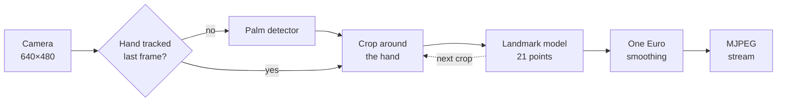

<div align="center">

# pi-virtual-whiteboard

**Real-time hand tracking on a Raspberry Pi 4 camera, streamed to your browser.**

[](https://www.python.org/)
[](https://www.raspberrypi.com/products/raspberry-pi-4-model-b/)
[](https://ai.google.dev/edge/litert)
[](https://ai.google.dev/edge/mediapipe/solutions/vision/hand_landmarker)
[](https://opencv.org/)
[](https://github.com/astral-sh/ruff)

</div>

## Run

From the laptop (the Pi is reached over SSH as `dar@rpi`; override with `PI_HOST`):

```sh
scripts/pi.py run                 # sync + run on the Pi, view at http://localhost:8000/
scripts/pi.py run --debug         # same, with model confidence scores on screen
scripts/pi.py run --prefer speed  # grainier image, ~5 ms less lag
```

### On a monitor plugged into the Pi

After `scripts/pi.py setup` from the laptop (copies the code and installs dependencies), in a
terminal on the Pi:

```sh
cd ~/pi-virtual-whiteboard
LIBCAMERA_LOG_LEVELS=WARN .venv/bin/pi-virtual-whiteboard   # same options as above
```

Then open http://localhost:8000/ in the Pi's browser (F11 for fullscreen). The browser shares the
Pi's CPU with the tracking, so expect a few fps less than viewing from the laptop.

## How it works



MediaPipe's palm detection and hand landmark models (lite variants) run directly on
[LiteRT](https://pypi.org/project/ai-edge-litert/) with 4 threads, following MediaPipe's own
pipeline: the slow palm detector only runs while no hand is tracked; otherwise the previous
frame's landmarks give the crop for the next, so only the fast landmark model runs.

> [!NOTE]
> The `mediapipe` package itself is not used: every recent wheel needs the ARM AES extension,
> which the Pi 4's CPU lacks (it crashes with `SIGILL`), and its Pi-compatible releases run
> single-threaded.

Landmark numbering: [`reference/hand_landmarks.png`](reference/hand_landmarks.png).

## Development

```sh
uv sync                  # install dependencies, including ruff and basedpyright
uv run ruff check        # lint (config in ruff.toml)
uv run ruff format       # format
uv run basedpyright      # type-check (config in pyproject.toml; stubs in typings/)
```
